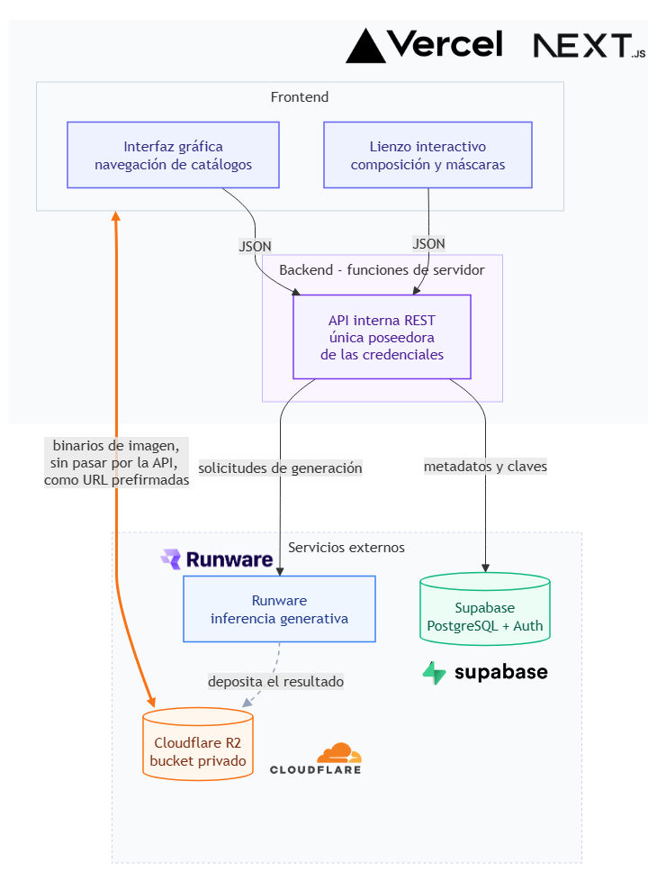
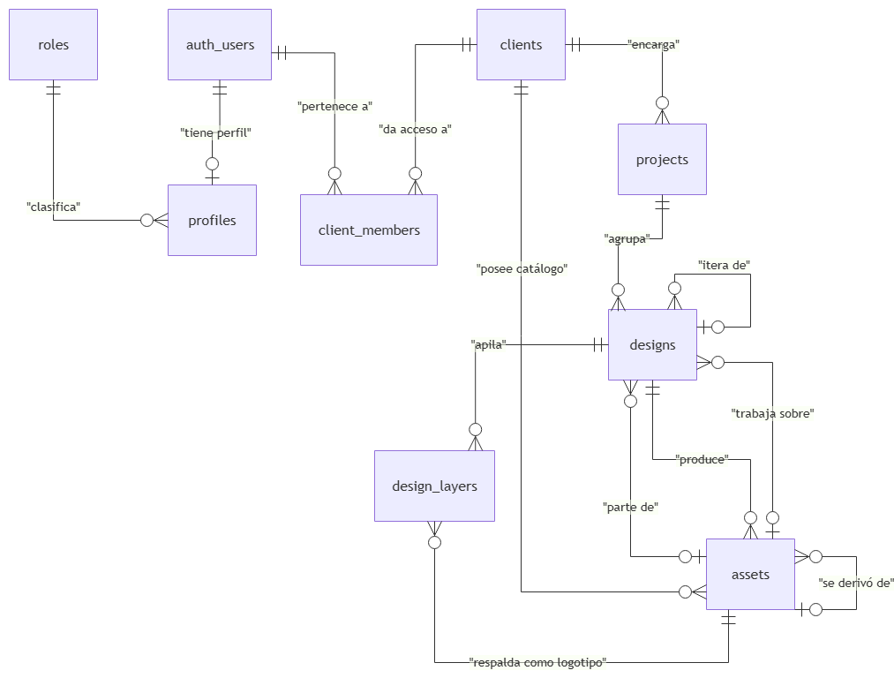

# Refashion IA

Sistema de prototipado de camisas y playeras corporativas asistido por inteligencia
artificial. Permite componer logotipos sobre una prenda, editarla por zonas o por
instrucción con modelos de difusión, y presentarla plana, sobre una persona fotografiada o
sobre una persona generada. Trabajo de graduación, Universidad del Valle de Guatemala.

Aplicación desplegada: https://refashion-tg.vercel.app/

Es una herramienta **interna**: no hay registro público. Los usuarios los crea un admin
desde `/admin/users`.

## Qué hace

- **Catálogos por cliente.** Clientes, proyectos y diseños, con un catálogo de imágenes por
  cliente: prendas base, logotipos y fotos de modelo. Subida, vista previa, renombrado,
  descarga y borrado con aviso de qué diseños usan cada imagen.
- **Composición de logotipos (Módulo 1).** Los logotipos se colocan como capas sobre la
  prenda, con mover, escalar y rotar. Quitar el fondo de un logotipo es un relleno por
  inundación en el navegador, sin modelos ni llamadas externas.
- **Edición de la prenda (Módulo 2).** Cuatro modos sobre la misma imagen de trabajo:
  - *Pintar prenda*: recoloreado determinista en el navegador, con el color exacto elegido.
  - *Completar la zona*: FLUX.1 Fill rellena una región marcada.
  - *Dibujar algo nuevo*: FLUX.1 dev dibuja dentro de una región, con intensidad ajustable.
  - *Editar por instrucción*: FLUX.1 Kontext modifica la imagen completa a partir de un texto.
- **Presentación (Módulo 3).** La prenda plana con sus logotipos, la prueba virtual sobre una
  foto de persona con P-Image Try-On, y la generación de personas con FLUX.1 dev. Los
  resultados quedan en la galería de productos finales del cliente.
- **Historial y costo.** Cada paso de edición queda en una tira navegable, y se puede volver
  a cualquiera sin generar de nuevo. Cada generación guarda el costo que factura el
  proveedor, el modelo, la semilla y la instrucción.

## Arquitectura



Una aplicación Next.js desplegada en Vercel, con tres servicios externos: **Supabase** para la
base de datos y la autenticación, **Cloudflare R2** para guardar las imágenes y **Runware**
para la inferencia de los modelos generativos. Los servicios no se comunican entre sí: la API
interna (`app/api/*`) es la única que tiene sus credenciales y la que los coordina.

Tres reglas sostienen ese diseño:

- **Las credenciales nunca llegan al navegador.** Next.js solo expone las variables con
  prefijo `NEXT_PUBLIC_`, y las de R2 y Runware no lo llevan.
- **El navegador nunca llama directo a un servicio que cobra.** Toda generación pasa por la
  API, que verifica la sesión y los permisos antes de gastar.
- **Las imágenes viven en R2 y la base solo guarda sus metadatos y su clave.**

Hay tres excepciones deliberadas al "todo pasa por la API": el inicio de sesión, que el
navegador negocia directo con Supabase; la subida de imágenes, que viaja del navegador a R2
con una URL prefirmada emitida por la API; y el resultado de una generación, que Runware
deposita directo en R2 con otra URL prefirmada.

## Stack

- **Next.js 16** (App Router), **React 19** y **TypeScript**. Sin backend separado: la API son
  Route Handlers en `app/api/*`.
- **Supabase** (`@supabase/ssr`, `@supabase/supabase-js`): Postgres, autenticación y Row Level
  Security.
- **Cloudflare R2** con el SDK de S3 (`@aws-sdk/client-s3`, `@aws-sdk/s3-request-presigner`).
- **Konva** (`konva`, `react-konva`) para el lienzo de composición y de máscaras.
- **Tailwind CSS v4** solo para los tokens de `app/globals.css`; los estilos de cada componente
  van en un CSS Module junto a él.
- **Zod 4** para validar los cuerpos de la API.

## Configuración

Cada servicio externo se configura siguiendo su guía oficial. Esta sección dice qué ajustes
necesita este proyecto en particular, no repite las guías.

### 1. Supabase

Crea el proyecto siguiendo la
[guía de Supabase para Next.js](https://supabase.com/docs/guides/getting-started/quickstarts/nextjs).
Su panel de conexión entrega la URL y la llave pública ya formateadas para el `.env.local`.

Dos ajustes del proyecto que el esquema da por hechos:

- **Desactiva "Automatically expose new tables"**. Cada tabla recibe sus permisos en su propia
  migración, así que una tabla no queda accesible solo por existir.
- **Row Level Security en todas las tablas.** Las migraciones lo habilitan; no lo desactives. La
  llave pública viaja al navegador por diseño, y sin políticas de fila cualquiera que la tenga
  podría leer las tablas completas.

Después corre las migraciones de `docs/`, **en orden**, en el SQL Editor de Supabase (ver
[Base de datos](#base-de-datos)).

**El primer admin.** Los usuarios nacen con rol `viewer`, y un trigger impide cambiar el rol
desde una sesión normal. Para crear el primero, agrégalo en Authentication > Users del panel y
promuévelo desde el SQL Editor:

```sql
update public.profiles
set role_id = (select id from public.roles where name = 'admin')
where email = 'tu-correo@ejemplo.com';
```

A partir de ahí, ese admin crea al resto de los usuarios desde `/admin/users`.

### 2. Cloudflare R2

Crea un bucket y un par de credenciales con la
[guía de compatibilidad con S3 de R2](https://developers.cloudflare.com/r2/get-started/s3/).
Para este proyecto:

- El bucket se queda **privado**. La app sirve las imágenes con URLs prefirmadas de vigencia
  corta.
- Las credenciales van **limitadas a ese bucket**, no a toda la cuenta.
- El bucket necesita una **política CORS**, aunque la app tenga un solo dominio: la subida va
  del navegador directo a R2, y sin esa política el navegador la bloquea. Se configura con la
  [guía de CORS de R2](https://developers.cloudflare.com/r2/buckets/cors/). La que usa el
  proyecto:

```json
[
  {
    "AllowedOrigins": ["http://localhost:3000", "https://<tu-proyecto>.vercel.app"],
    "AllowedMethods": ["GET", "PUT"],
    "AllowedHeaders": ["Content-Type"],
    "MaxAgeSeconds": 3600
  }
]
```

### 3. Runware (opcional)

Sin una llave de Runware, la app **funciona igual contra un simulador**: devuelve imágenes de
prueba, no cobra nada y lo dice en pantalla. Así se puede recorrer toda la interfaz sin gastar.

Para generar de verdad, crea una llave en el panel de Runware
([autenticación](https://runware.ai/docs/models-api/authentication)) y ponla en
`API_KEY_RUNWARE_PROD`. Runware trabaja con saldo prepagado y no tiene nivel gratuito. Cada
generación se cobra.

El uso de los modelos FLUX queda sujeto a la
[política de uso de Black Forest Labs](https://bfl.ai/legal/usage-policy).

### 4. Variables de entorno

Copia `.env.example` a `.env.local` y llénalo. `.env.local` está fuera del control de versiones.

| Variable | Dónde se usa | Qué es |
|---|---|---|
| `NEXT_PUBLIC_SUPABASE_URL` | navegador y servidor | URL del proyecto, sin barra final |
| `NEXT_PUBLIC_SUPABASE_PUBLISHABLE_KEY` | navegador y servidor | Llave pública (`sb_publishable_...`) |
| `SUPABASE_SECRET_KEY` | solo servidor | Llave secreta (`sb_secret_...`), para crear y administrar usuarios |
| `R2_ACCOUNT_ID`, `R2_ACCESS_KEY_ID`, `R2_SECRET_ACCESS_KEY`, `R2_BUCKET`, `R2_ENDPOINT` | solo servidor | Cuenta, credenciales, bucket y endpoint de R2 |
| `API_KEY_RUNWARE_PROD` | solo servidor | Llave de Runware de la app. Vacía, se usa el simulador |

`RUNWARE_API_KEY` también aparece en `.env.example`, pero la app no la lee: es la de los
scripts de experimentos, que viven fuera de este repositorio. Están separadas para que correr
un experimento no encienda el gasto de la app sin que nadie lo decida.

### 5. Desarrollo local

```bash
npm install
npm run dev
```

Abre http://localhost:3000. Sin sesión, cualquier página redirige a `/login`.

Desarrollo y producción pueden apuntar a la misma base y al mismo bucket. Si lo hacen, lo que
hagas en local se ve en producción.

### 6. Despliegue en Vercel

Enlaza el repositorio con un proyecto de Vercel siguiendo
[su guía de integración con Git](https://vercel.com/docs/git). Framework Preset **Next.js** y
Root Directory vacío. Cada push a `main` despliega a producción, y cada rama genera una vista
previa con su propia dirección.

- **Las variables de entorno se declaran otra vez en Vercel**, en la configuración del proyecto:
  `.env.local` no viaja con el repositorio.
- **Las rutas de generación declaran `maxDuration = 150`** segundos, para esperar a un
  proveedor lento sin cortar una llamada ya cobrada. Un valor mayor a 60 necesita *Fluid
  compute*, que viene activado por omisión en los proyectos nuevos.
- Agrega el dominio de producción a la política CORS del bucket.

## Verificación

Antes de integrar una rama, las tres tienen que pasar sin error:

```bash
npx tsc --noEmit
npm run lint
npm run build
```

`build` es la más lenta y la única que compila todas las pantallas juntas, así que es la que
encuentra los fallos que solo aparecen al hacerlo.

Además, dos búsquedas que vigilan que no haya colores ni espaciados escritos a mano fuera de
`app/globals.css`. La de colores devuelve `themeColor` en `app/layout.tsx`, que no puede ser un
token porque termina en una etiqueta `<meta>`, y un comentario de `ColorPanel.tsx` que menciona
un hexadecimal de ejemplo; cualquier otra línea es un error. La de espaciado devuelve una lista
corta de excepciones justificadas: los solapes de 1 px y los despejes para iconos dentro de
un campo.

```bash
grep -rEn '#[0-9a-fA-F]{3,8}\b' app components --include=*.tsx --include=*.module.css
grep -rEn '^[[:space:]]*(padding|margin|gap|row-gap|column-gap)(-(top|right|bottom|left))?[[:space:]]*:[^;]*[0-9]([.][0-9]+)?(rem|px)' app components --include=*.module.css
```

## Lighthouse

Cinco pantallas de la aplicación desplegada, evaluadas con la cuenta de solo lectura y
Lighthouse 13.5.0 en escritorio emulado:

| Pantalla | Performance | Accessibility | Best Practices | SEO |
|---|---|---|---|---|
| Lista de clientes | 100 | 96 | 100 | 100 |
| Recursos de un cliente | 95 | 96 | 100 | 100 |
| Productos de un cliente | 95 | 96 | 100 | 100 |
| Edición de un diseño | 97 | 97 | 100 | 100 |
| Presentación de un diseño | 91 | 96 | 100 | 100 |

Best Practices llega a 100 en las cinco en parte por las cabeceras `X-Frame-Options` y
`Cross-Origin-Opener-Policy` que fija `next.config.ts`. Los informes completos de cada corrida
están en `lighthouse-reports/`.

## Base de datos

Ocho tablas propias, más `auth.users`, que administra Supabase y que el esquema no modifica.



| Tabla | Qué registra | Columnas principales |
|---|---|---|
| `roles` | Los roles globales | `name`, `description` |
| `profiles` | El perfil de cada usuario, colgado de su cuenta en `auth.users` | `first_name`, `last_name`, `email`, `role_id` |
| `client_members` | Qué usuario tiene acceso a qué cliente, y con qué rol | `client_id`, `user_id`, `role` |
| `clients` | Cada negocio que encarga uniformes | `name`, `nit`, `address`, `city`, `country`, `phone`, `email`, `notes` |
| `projects` | Una orden o campaña dentro de un cliente | `client_id`, `name`, `description`, `status` |
| `designs` | Una prenda concreta dentro de un proyecto | `project_id`, `name`, `garment_type`, `version`, `status`, `notes`, `base_asset_id`, `current_asset_id`, `parent_design_id` |
| `design_layers` | Los logotipos colocados sobre un diseño | `design_id`, `asset_id`, `x_ratio`, `y_ratio`, `width_ratio`, `rotation_deg`, `z_index` |
| `assets` | Toda imagen del sistema, subida o generada | Identidad (`r2_key`, `asset_type`, `origin`, `mime_type`, tamaño y medidas), pertenencia (`client_id` o `design_id`), linaje (`parent_asset_id`, `mask_asset_id`, `person_asset_id`) y generación (`generation_model`, `generation_prompt`, `generation_seed`, `generation_steps`, `generation_strength`, `generation_latency_ms`, `runware_task_id`, `cost_usd`) |

Una imagen pertenece al catálogo de un cliente (`client_id`) o a un diseño (`design_id`). La
base exige que tenga al menos uno de los dos; que no tenga los dos a la vez lo cumple la
aplicación, no una restricción. Las coordenadas de las capas se guardan como proporciones y no como píxeles, para que el logotipo
conserve su lugar cuando un paso de edición cambia el tamaño de la imagen de trabajo.

Las migraciones están en `docs/`, numeradas. Se ejecutan **en orden** en el SQL Editor de
Supabase y **solo se agregan**: nunca se edita una ya aplicada, porque dejaría de describir lo
que hay en la base.

**El SQL va primero.** Si un cambio trae una migración, se corre **antes** de desplegar el
código que la usa. Al revés, la app falla en silencio: una columna que no existe hace fallar
la consulta entera, y la pantalla muestra datos vacíos en vez de un error.

| # | Qué hace |
|---|---|
| 001 | Tablas y RLS inicial |
| 002 | Políticas por rol de miembro (`owner`, `editor`, `viewer`) y sus funciones auxiliares |
| 003 | `create_client_with_owner`: crea el cliente y su owner en una sola operación |
| 004 | Permisos de tabla para `authenticated` |
| 005 | Rol global (`admin`, `editor`, `viewer`), acceso total del admin y trigger contra la autoescalada de rol |
| 006 | Descripciones de los roles y permisos de ejecución de las funciones |
| 007 | Permisos de `service_role`, para la administración de usuarios |
| 008 | `assets.original_filename` |
| 009 | Teléfono y correo del cliente |
| 010 | Prenda base y diseño padre; la versión pasa a derivarse |
| 011 | Estado del diseño (`draft`, `active`, `completed`) |
| 012 | Tercer origen de imagen, `derived` |
| 013 | Imagen de trabajo actual y la tabla de capas de logotipo |
| 014 | Vistas de solo lectura que alimentan las listas |
| 015 | Conteos para las confirmaciones de borrado |
| 016 | Ancho y alto de cada imagen |
| 017 | Vínculo de cada generación con la máscara que la produjo |
| 018 | Semilla, modelo y pasos de cada generación |
| 019 | La persona sobre la que se hizo cada prueba virtual |
| 020 | Intensidad y latencia de cada generación |
| 021 | Limpieza de datos: borra los nombres automáticos de las imágenes generadas. No cambia el esquema |
| 022 | Visibilidad de miembros y del directorio de usuarios; solo el owner agrega miembros |

Una tabla nueva necesita **cuatro** pasos en su migración, no dos: crearla, habilitar RLS,
escribir sus políticas y otorgar los permisos a `authenticated`. Con la exposición automática
desactivada, una tabla sin permisos queda ilegible aunque sus políticas sean correctas.

## Permisos

Hay dos capas de roles:

| Capa | Valores | Qué decide |
|---|---|---|
| Rol global, en el perfil | `admin`, `editor`, `viewer` | `admin` ve y administra todo, usuarios incluidos. `editor` además puede crear clientes. `viewer` no crea clientes |
| Rol en cada cliente | `owner`, `editor`, `viewer` | Qué puede hacer dentro de ese cliente |

Un usuario sin membresía no ve ningún cliente. Un miembro `viewer` solo lee: no edita, no
genera y no ve a los demás miembros. Los permisos los impone el RLS de la base; la interfaz
solo oculta lo que no se puede hacer, y las rutas que gastan dinero lo comprueban además antes
de llamar al proveedor.

## Convenciones

Reglas que el código ya asume. Romper cualquiera produce un error que no siempre falla de
inmediato.

**Leer y escribir van por caminos distintos.** Los Server Components consultan Supabase
directo, y el RLS aplica igual. Las escrituras van siempre por `app/api/*` desde componentes
cliente, con `lib/api-client.ts`.

**`lib/` es la capa de acceso a datos y autorización.** Una regla de seguridad escrita dentro
de una sola ruta protege solo esa ruta, y la siguiente que toque la misma columna nace
desprotegida. Por eso las reglas viven en `lib/`.

**El corte cliente y servidor dentro de `lib/`.** Un archivo que importe un componente cliente
no puede importar `lib/r2` ni nada con credenciales. `lib/assets.ts` se puede importar desde el
navegador; `lib/assets-server.ts` firma URLs y no. `lib/r2.ts` y `lib/generation/` empiezan con
`import "server-only"`, para que un import equivocado sea un error de compilación y no una fuga
silenciosa.

**Ningún valor literal fuera de `app/globals.css`.** Ni colores ni tamaños en un `.tsx` o un
`.module.css`: siempre el token (`var(--color-accent)`, `var(--space-14)`).

**Un `.module.css` por componente, junto a él.** Si un estilo hace falta en dos lugares, se
extrae un componente a `components/ui/`.

**Las versiones importan.** Next 16: el middleware se llama `proxy.ts`, `cookies()` es async y
los `params` de las rutas dinámicas son `Promise`. React 19: `SyntheticEvent`, no `FormEvent`.
Zod 4: `z.email()`, `z.uuid()`, `z.enum()`.

**El código va en inglés y la interfaz en español**, con tuteo.

## Decisiones

El razonamiento completo está en el trabajo de graduación. Esto es lo mínimo para no deshacer
una decisión sin querer.

- **Acceso por membresía, no por propiedad.** No hay `owner_id`: el acceso a un cliente es una
  fila en `client_members`, así que sumar usuarios es agregar datos, no migrar. Un cliente
  nunca puede quedarse sin owner.
- **Las llaves foráneas se verifican además del RLS.** Una llave foránea garantiza que el UUID
  existe, no que el usuario pueda usarlo. Cada columna de ese tipo que se escribe desde la API
  tiene su comprobación de pertenencia explícita.
- **Lo que es un hecho se deriva, lo que decide el usuario se guarda.** Por eso `version` se
  calcula y `status` se guarda.
- **El logotipo es una capa y no se aplana.** Se compone al final, sobre la imagen de trabajo
  del momento, para que ningún modelo generativo reciba una imagen con el logotipo pegado: la
  difusión lo deformaría.
- **El color exacto se pinta, no se pide.** Los modelos de difusión no respetan un código de
  color de forma confiable. El recoloreado es determinista y entrega el mismo hexadecimal que
  se eligió.
- **`origin` tiene tres valores**: `upload` (lo subió una persona), `derived` (lo produjo la app
  sin IA, como un recorte o una composición) y `generated` (lo produjo un modelo).
- **Un logotipo SVG se acepta pero no se guarda como vector.** Se convierte a PNG de 2048 px al
  subirlo, para que todo objeto en R2 sea una imagen que el lienzo pueda dibujar.
- **Las generaciones se guardan en WEBP.** Pesan unas veinticinco veces menos que en PNG, con
  una diferencia visual imperceptible, y los cuatro modelos lo aceptan como entrada.
- **El borrado en cascada de Postgres no llega a R2.** Las claves de los objetos se leen antes
  de borrar las filas, y los archivos se limpian después.

## Documentación fuera del repositorio

El trabajo de graduación documenta la metodología, la configuración con sus referencias y los
resultados de la caracterización de cada modelo. Los scripts de experimentos y los documentos
de seguimiento del desarrollo viven fuera de este repositorio.
