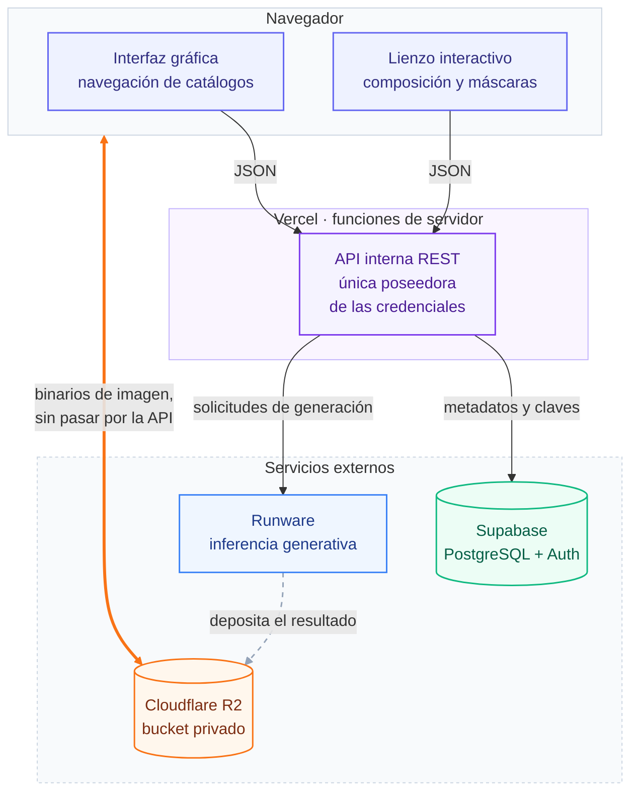
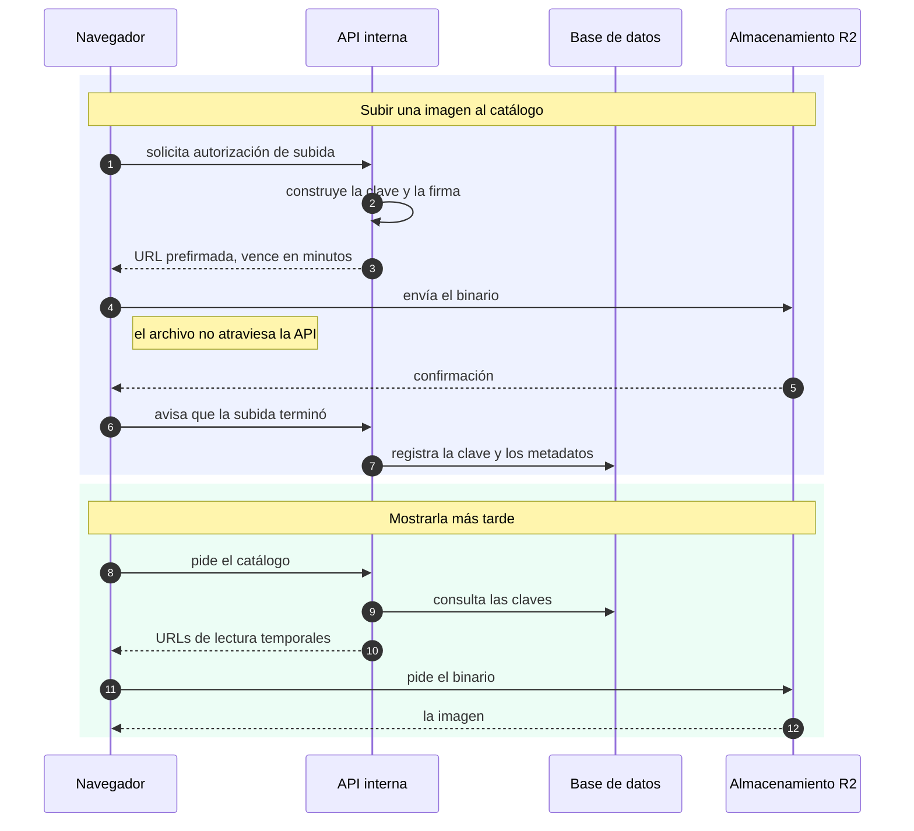
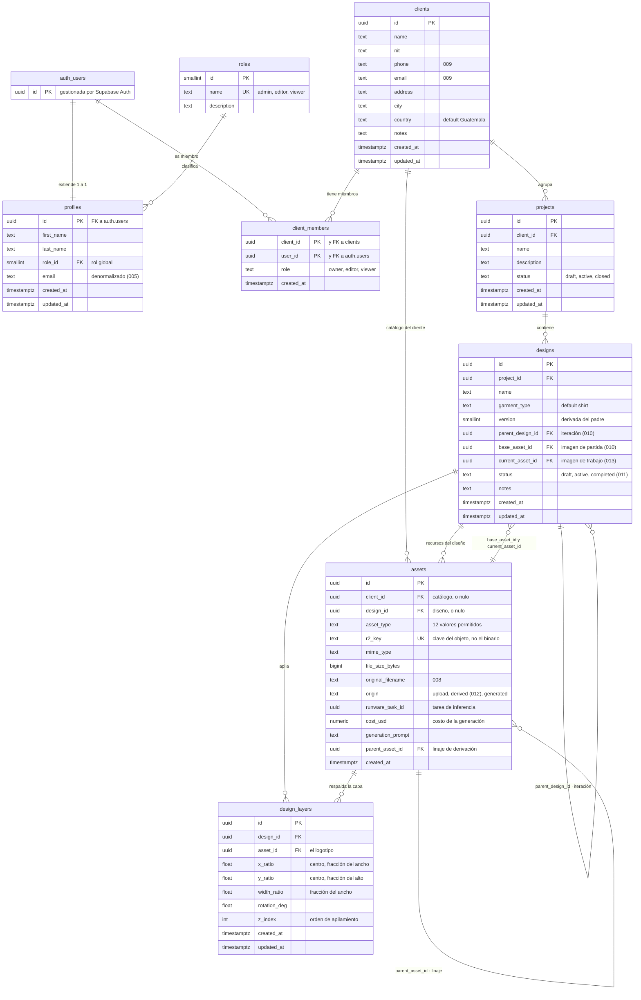

# Diagramas del sistema

> Diagramas en Mermaid, que GitHub y VS Code renderizan directo en este archivo.
> El código también se puede importar a draw.io (*Arrange → Insert → Advanced → Mermaid*)
> para retocar iconos y disposición.
>
> **Cada diagrama responde una sola pregunta**, que es lo que los mantiene legibles:
>
> | # | Pregunta | Tipo | Sección del documento |
> |---|---|---|---|
> | 1 | ¿Qué piezas hay y quién habla con quién? | Estructural | 7.2 Arquitectura del sistema |
> | 2 | ¿En qué orden ocurre, y por dónde viaja el binario? | Secuencia | 7.4 Gestión de catálogos |
> | 3 | ¿Cómo se relacionan los datos? | Entidad-relación | 7.3 Modelo de datos |
>
> **Fuente de verdad del esquema:** las migraciones `001` a `015` de esta misma carpeta. Si
> una migración nueva cambia una tabla, este archivo queda desactualizado hasta que se corrija.
> Estado reflejado aquí: migración `015`.

---

## 1. Arquitectura del sistema

Este diagrama responde una sola pregunta: **qué piezas hay y quién habla con quién.** No
describe el orden de las operaciones; para eso está el diagrama 2.

**Cómo leer los colores**

| Color | Capa |
|---|---|
| Índigo (navegador) | Todo lo que corre en el cliente |
| Morado (Vercel) | La única capa que ve credenciales y orquesta llamadas externas |
| Verde (Supabase) | Metadatos: usuarios, diseños, claves de objetos |
| Naranja (Cloudflare R2) | Binarios de imagen |
| Azul (Runware) | Inferencia generativa |

**Lo que la forma del dibujo dice por sí sola**

1. **Solo una caja toca los servicios de pago.** Todas las flechas hacia Runware y las llaves
   de R2 salen de la API. El navegador no tiene ninguna.
2. **Hay un camino que esquiva la API.** La flecha gruesa naranja entre el navegador y R2 es
   el único trazo del diagrama que no pasa por Vercel, y por ahí van los binarios. Es un
   hecho estructural, no una secuencia: no necesita número de paso para entenderse.
3. **Los dos almacenes están separados.** Supabase guarda la clave del objeto; R2 guarda el
   objeto.

> La flecha gris punteada de Runware hacia R2 corresponde a los módulos 2 y 3, todavía sin
> construir. El proveedor deposita el resultado en el bucket sin rebotar por el servidor.

---

## 2. Recorrido de una imagen

Aquí sí importa el orden, y por eso es un diagrama de secuencia y no un diagrama de cajas.
Lo que hay que ver es que **ninguna flecha del binario cruza la columna de la API**: lo único
que la API entrega es una autorización firmada de unos cientos de bytes.

> **Nota de color.** Mermaid no permite colorear cada `participant` por separado de forma
> confiable entre GitHub, VS Code y draw.io — solo existe una variable de tema global que
> pintaría a todos los actores igual, así que no serviría para distinguir capas como en el
> diagrama 1. En su lugar, cada `rect` de fase lleva un tinte de la misma paleta.

**Por qué el binario no pasa por el servidor.** Atravesar la función consumiría su tiempo de
ejecución y chocaría con el límite de tamaño de una petición. El patrón de URL prefirmada
traslada la transferencia al navegador y deja al servidor solo la decisión de autorizarla,
que es la parte que exige credenciales.

## 3. Modelo entidad-relación

Ocho tablas propias más `auth.users`, que administra Supabase Auth y que este esquema nunca
modifica: `profiles` la extiende uno a uno.

La cadena de acceso es `auth.users → client_members → clients → projects → designs → assets`.
Toda política de seguridad a nivel de fila la recorre para decidir qué ve cada usuario.

> **Nota de estilo.** Mermaid no soporta `classDef`/`style` sobre entidades dentro de un
> `erDiagram` en ningún renderer estable todavía, así que este diagrama no lleva colores por
> tabla — cualquier intento se ve inconsistente entre GitHub, VS Code y draw.io.

**Decisiones de modelado que el diagrama deja ver**

| Qué se ve | Por qué está así |
|---|---|
| `clients` no tiene columna de propietario | El acceso se modela por membresía en `client_members`. Sumar un usuario es una fila, no una migración de esquema |
| `assets` cuelga de `clients` **o** de `designs` | Son dos ciclos de vida: el catálogo existe antes de cualquier proyecto; los recursos de un diseño nacen y mueren con él. Una restricción exige que al menos uno esté presente |
| `assets` y `designs` se referencian a sí mismas | `parent_asset_id` reconstruye la cadena de transformaciones de una imagen; `parent_design_id` distingue una propuesta de su iteración siguiente |
| `designs` apunta dos veces a `assets` | `base_asset_id` es de dónde partió; `current_asset_id` es sobre qué se trabaja ahora. Dejan de coincidir en cuanto corre un módulo generativo |
| Las capas están en tabla y no en un campo JSON | La llave foránea hacia `assets` hace que «qué diseños usan este logotipo» sea una consulta directa, que es lo que necesita el aviso previo al borrado |
| Las coordenadas son fracciones y no píxeles | La capa se reaplica sobre cualquiera que sea la imagen de trabajo, y su resolución cambia a lo largo del flujo |

> **Nota sobre el tipo de las coordenadas.** En el esquema son `double precision`; aquí
> aparecen como `float` porque Mermaid no admite el nombre compuesto.

---

## Mantenimiento

Al agregar una migración que cambie tablas o columnas, actualizar el bloque
`erDiagram` y la línea de «Estado reflejado aquí» del encabezado. Un diagrama que miente es
peor que ninguno.